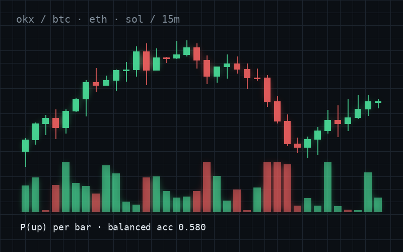
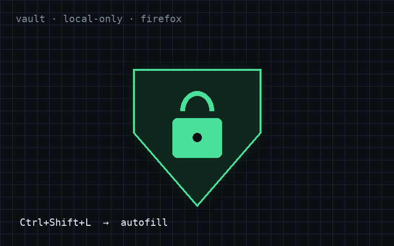
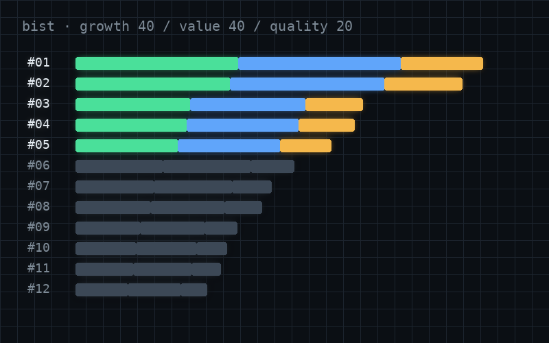

<h1 align="center">kaan ulusoy</h1>

<code>quant finance / machine learning / security</code>

now <b>building guidetrade</b>

  <a href="https://SITE-ADRESIN">Website</a> &nbsp;/&nbsp;
  <a href="https://www.linkedin.com/in/LINKEDIN-KULLANICI-ADIN">LinkedIn</a> &nbsp;/&nbsp;
  <a href="mailto:kaanulusoy321@gmail.com">Get in touch</a>

I'm **Kaan**, a computer engineer working where markets meet machine learning. I collect my own data, straight from the exchange, and take it all the way to a model and a signal I can actually test.

## Start here

<table>
<tr>
<td width="46%" valign="top">

</td>
<td width="54%" valign="top">

**01 / RESEARCH**

### [okx-lstm-pipeline](https://github.com/KaanUlusoytxt/okx-lstm-pipeline)

End-to-end pipeline from live OKX trade flow to a 15-minute price-direction LSTM on BTC, ETH and SOL. 16 scale-free orderflow features, full ablation study and confidence gating. Balanced accuracy 0.580 against a 0.518 naive baseline, 62–71% hit rate above the confidence threshold. Written up as an IEEE conference paper.

</td>
</tr>
<tr>
<td width="46%" valign="top">

</td>
<td width="54%" valign="top">

**02 / TOOLS**

### [Passkeeper](https://github.com/KaanUlusoytxt/passkeeper)

A password manager that never leaves my machine: local desktop vault plus a signed Firefox extension that fills credentials with one shortcut over a verified browser link.

</td>
</tr>
<tr>
<td width="46%" valign="top">

</td>
<td width="54%" valign="top">

**03 / QUANT**

### [bist-screener](https://github.com/KaanUlusoytxt/bist-screener)

Systematic fundamental screener for Borsa Istanbul. Ranks companies by percentile on growth, value and quality (40 / 40 / 20) across four index universes and picks the top five each month, tracked as a paper portfolio.

</td>
</tr>
</table>

<a href="https://SITE-ADRESIN">SITE-ADRESIN</a>

